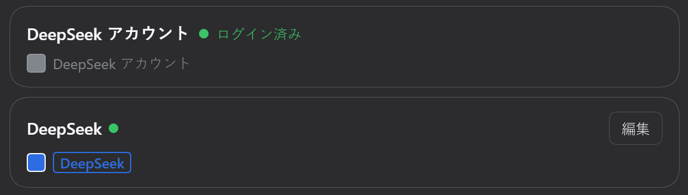

# dsh-model-provider-info

**日本語** · [English](README.md) · [简体中文](README.zh-CN.md) · [한국어](README.ko.md)

[](https://github.com/yanxijian/dsh-model-provider-info/actions/workflows/hygiene.yml)
[](https://www.npmjs.com/package/dsh-model-provider-info)
[](LICENSE)

<!-- translated-from: README.md sha256:807f4df950a9 -->

DeepSeek Harness の入力欄のモデル位置に、モデル名より前にプロバイダー名を表示し、サードパーティの経路には
独自の視覚的な重みを与えます。

入力欄は現在のモデルを 3 か所（トリガーのキャプション、ルートメニューの現在値、各選択行）で示しますが、
単体ではカタログ上のモデル名しか描画しません。2 つのプロバイダーが同名のモデルを提供すると、それだけで
曖昧になります。このバンドルは `conversation.input.model.label` インラインスロットを引き受けるので、同じ
ラベルが `DeepSeek-V4.1-Flash` ではなく `DeepSeek アカウント · DeepSeek-V4.1-Flash` と表示され、推論強度は
引き続きその横に別のキャプションとして残ります。

## 表示例



**設定 → モデル** の各プロバイダーカードには、色スウォッチが 1 つと、入力欄が描画する名前のプレビューが
あります。DeepSeek アカウントの行は既定のグレー文字のまま、DeepSeek API の経路は選んだ色の枠線チップで
表示されます。

## ファーストパーティとサードパーティ

`deepseek-account` と `deepseek-official` がファーストパーティで、それ以外の provider id はすべて
サードパーティです。この区分は製品自身の並び順（`ui-model-selection` の `provider-order.ts`、
`ui-settings-models` の `store.ts` がいずれもこの 2 つの id だけを特例扱い）に従っています。

強調は表示面ごとに段階を付け、一覧が警告の壁にならないようにしています：

| 表示面 | ファーストパーティ | サードパーティ |
|---|---|---|
| モデルトリガー | 通常のキャプション文字 | `#F61A43` の枠線チップ：12px、ウェイト 600、1px 枠、`--dsw-radius-xs`、透明背景 |
| メニューの「モデル」現在値 | 上と同じ | 同じチップ（ここも現在の選択） |
| 展開した一覧の行 | 通常のキャプション文字 | `--dsw-alias-label-secondary` + ウェイト 500、色なし、枠なし |

一覧の行を控えめにしているのは意図的です。各グループにはすでにプロバイダー名の見出しがあるので、行ごとに
チップを付けるとプロバイダーを二度言うことになり、列が赤く塗られます。

プロバイダーがモデルに付けるカタログバッジ（`model.badge`、組み込みラベルが描くのと同じ `Tag`）もここで
再現しています。トリガーでは名前の前、メニューと行では名前の後に出ます。

## 設定

**設定 → モデル**。2 か所、ブラウザーごとに保存されます。

**各プロバイダーカード**の末尾に色アイコンが 1 つあります。クリックでそのプロバイダーの色を選び、アイコンは
実際に使われている色を示します（枠が太い場合は既定値ではなく独自の色）。ボードの「既定に従う」で既定色に戻せます。

**下部のカード**が既定値を決めます：

| オプション | 既定 | 効果 |
|---|---|---|
| 既定の色 | `#F61A43` | アイコンで選ぶ。独自の色を持たないプロバイダーが使う |
| 一覧の行にも色を付ける | オフ | オフ：展開した行は色調とウェイトだけの違い。オン：枠線チップも付く |
| DeepSeek の経路にもプロバイダーを表示 | オン | オフ：`deepseek-account` / `deepseek-official` はモデル名だけ |

DeepSeek 自身の経路に色を選ぶと、その経路もチップ表示に切り替わります。明示的な色は「見たい」という意思
表示だからです。両方の表示面は 1 つのライブレコードを共有するので、変更は入力欄にすぐ反映されます。

## インストール

```sh
dsh plugin --profile <profile> add dsh-model-provider-info
```

デスクトップ版は **プラグイン → プラグインを追加** から入れます。DSH Desktop が動いているマシンでは、上の
CLI コマンドはアプリが使うプロファイルではなく `profiles/web` を対象にします。

チェックアウトから入れる場合：`dsh plugin --profile <profile> add link:/path/to/dsh-model-provider-info`。

ビルド手順なし、実行時依存なし、ネットワークアクセスなし。DSH をアップグレードしても消えません。コンパイル
済みバンドルにパッチを当てるのではなく、公式スロットを登録するからです。

## 意図的なトレードオフ

- `#F61A43` は既定のアクセント色で、テーマトークンではなくリテラルな色です。ユーザーが選ぶものだからです。
  それ以外はすべてトークンに乗せています。
- 塗りつぶしではなく枠線：同じ色相の淡い背景に乗せたアクセント文字はコントラストを約 5 分の 1 失い、1px の
  枠だけでも十分バッジに見えます。
- `Custom` タグの 11px / 400 ではなく 12px / 600：このアクセントは中間色で、明るいカード上で約 4.07:1、
  暗い入力欄の上で約 3.4:1 しかなく、11px の regular では支えきれません。
- 枠は 0.5px ではなく 1px：100% DPI の Windows では半ピクセルの線がぼやけるか消えます。
- プロバイダーの span は素の inline のままにして、13px のモデル名とベースラインを共有します。
  - 枠は下方向に 1px だけ広げます（文字を上にずらすのではなく）。inline ボックスの垂直 padding は
    枠だけを広げて文字は動かさないため、ラベルはモデル名と共有するベースライン上に留まります。1px が
    上限です——ホストはこのラベルを 20px 行ボックス（`overflow: hidden`）で包み、チップ自体すでに
    18px あります。一覧の行は 18px しかないため、そこではこの 1px を足しません（足すと下枠が切れます）。小文字だけの名前（`wps`）は ascender を持たないため枠内で約 1px 低く見えますが、
    それは字形の問題で、インクを動かすとモデル名と共有するベースラインが崩れます。
- `priority` は不要です。0.2.1 以降、ホストのこの single スロットには組み込みの占有者がいません。

## 制限

- 表示のみです。選択、検索、フォーカス、チェックマーク、`/model` コマンドのポップアップ、トリガーの
  アクセシブル名はモデルセレクターが持ち続けます。
- 設定は `localStorage` の `dsh-model-provider-info/settings/v1` にあり、プロファイル単位ではなく
  ブラウザー単位です。
- 長い名前はトリガー内で省略されます。チップとバッジもその幅の一部です。

## 公開

パッケージは npm に `dsh-model-provider-info` として公開されています。`repository`、`homepage`、`bugs` は
すでにこのリポジトリーを指しています。変更を出すには `version` を上げてから：

```sh
npm publish --registry https://registry.npmjs.org --access public
```

パッケージはスコープなしなので `--access public` は暗黙ですが、意図を明示するために書いています。npm の
`repository` はプラグインカタログに登録されたリポジトリーを指し続けてください。そうでないと両者が
結び付きません。

## ライセンス

[MIT](LICENSE)
