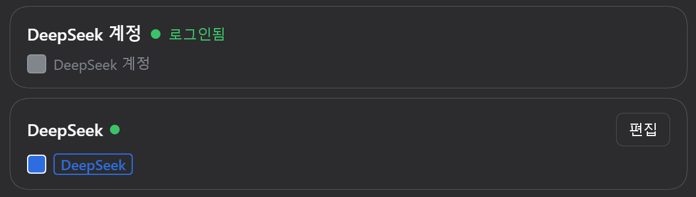

# dsh-model-provider-info

**한국어** · [English](README.md) · [简体中文](README.zh-CN.md) · [日本語](README.ja.md)

[](https://github.com/yanxijian/dsh-model-provider-info/actions/workflows/hygiene.yml)
[](https://www.npmjs.com/package/dsh-model-provider-info)
[](LICENSE)

<!-- translated-from: README.md sha256:807f4df950a9 -->

DeepSeek Harness 입력창의 모델 자리에 모델 이름 앞에 공급자 이름을 표시하고, 서드파티 경로에는 고유한
시각적 무게를 부여합니다.

입력창은 현재 모델을 세 곳(트리거 캡션, 루트 메뉴의 현재 값, 각 선택 행)에서 보여 주지만, 그 자체로는
카탈로그의 모델 이름만 그립니다. 두 공급자가 같은 이름의 모델을 제공하는 순간 모호해집니다. 이 번들은
`conversation.input.model.label` 인라인 슬롯을 맡아서, 같은 라벨이 `DeepSeek-V4.1-Flash` 대신
`DeepSeek 계정 · DeepSeek-V4.1-Flash` 로 읽히게 하고, 추론 강도는 계속 그 옆에 별도 캡션으로 남습니다.

## 어떻게 보이는지



**설정 → 모델** 의 모든 공급자 카드에는 색상 견본 하나와 입력창이 그릴 이름의 미리보기가 있습니다.
DeepSeek 계정 행은 기본 회색 텍스트를 유지하고, DeepSeek API 경로는 선택한 색의 테두리 칩으로 표시됩니다.

## 퍼스트파티와 서드파티

`deepseek-account` 와 `deepseek-official` 이 퍼스트파티이고, 그 밖의 모든 provider id 는 서드파티입니다.
이 구분은 제품 자체의 정렬 규칙(`ui-model-selection` 의 `provider-order.ts`, `ui-settings-models` 의
`store.ts` 가 모두 이 두 id 만 특별 취급)을 따릅니다.

강조는 표면별로 단계를 두어 목록이 경고의 벽이 되지 않게 합니다:

| 표면 | 퍼스트파티 | 서드파티 |
|---|---|---|
| 모델 트리거 | 일반 캡션 텍스트 | `#F61A43` 테두리 칩: 12px, 굵기 600, 1px 테두리, `--dsw-radius-xs`, 투명 배경 |
| 메뉴의 "모델" 현재 값 | 위와 같음 | 같은 칩 (여기도 현재 선택) |
| 펼친 목록 행 | 일반 캡션 텍스트 | `--dsw-alias-label-secondary` + 굵기 500, 색 없음, 테두리 없음 |

목록 행을 일부러 조용하게 둔 이유는, 각 그룹에 이미 공급자 이름이 제목으로 있기 때문입니다. 행마다 칩을
달면 공급자를 두 번 말하게 되고 열 전체가 빨갛게 칠해집니다.

공급자가 모델에 붙이는 카탈로그 배지(`model.badge`, 내장 라벨이 그리는 것과 같은 `Tag`)도 여기서
재현합니다. 트리거에서는 이름 앞에, 메뉴와 행에서는 이름 뒤에 나옵니다.

## 설정

**설정 → 모델**. 두 곳이며 브라우저별로 저장됩니다.

**모든 공급자 카드** 끝에 색상 아이콘이 하나 있습니다. 클릭하면 그 공급자의 색을 고를 수 있고, 아이콘은
현재 쓰이는 색을 보여 줍니다(테두리가 두꺼우면 기본값이 아니라 자체 색을 가진 것). 더블클릭하면 기본값으로
돌아갑니다.

**하단 카드**가 기본값을 정합니다:

| 옵션 | 기본값 | 효과 |
|---|---|---|
| 기본 색 | `#F61A43` | 아이콘에서 고름. 자체 색이 없는 공급자가 사용 |
| 목록 행에도 색 적용 | 꺼짐 | 꺼짐: 펼친 행은 색조와 굵기만 다름. 켜짐: 테두리 칩도 붙음 |
| DeepSeek 경로에도 공급자 표시 | 켜짐 | 꺼짐: `deepseek-account` / `deepseek-official` 은 모델 이름만 표시 |

DeepSeek 자체 경로에 색을 고르면 그 경로도 칩 표시로 바뀝니다. 명시적인 색은 "보고 싶다"는 요청이기
때문입니다. 두 표면은 하나의 실시간 레코드를 공유하므로 변경이 입력창에 즉시 반영됩니다.

## 설치

```sh
dsh plugin --profile <profile> add dsh-model-provider-info
```

데스크톱 사용자는 **플러그인 → 플러그인 추가** 로 설치합니다. DSH Desktop 이 실행 중인 머신에서 위 CLI
명령은 앱이 쓰는 프로필이 아니라 `profiles/web` 을 대상으로 합니다.

체크아웃에서 설치: `dsh plugin --profile <profile> add link:/path/to/dsh-model-provider-info`.

빌드 단계 없음, 런타임 의존성 없음, 네트워크 접근 없음. DSH 를 업그레이드해도 사라지지 않습니다. 컴파일된
번들을 패치하는 대신 공식 슬롯을 등록하기 때문입니다.

## 의도적인 트레이드오프

- `#F61A43` 은 기본 강조색으로, 테마 토큰이 아닌 리터럴 색입니다. 사용자가 직접 고르기 때문입니다.
  나머지는 모두 토큰 위에 있습니다.
- 채우지 않고 테두리만: 같은 색조의 옅은 배경 위에 얹은 강조 텍스트는 대비를 약 5분의 1 잃고, 1px 테두리
  만으로도 충분히 배지처럼 읽힙니다.
- `Custom` 태그의 11px / 400 대신 12px / 600: 이 강조색은 중간 톤이라 밝은 카드에서 약 4.07:1, 어두운
  입력창 위에서 약 3.4:1 에 그쳐 11px regular 로는 버티지 못합니다.
- 테두리는 0.5px 이 아니라 1px: 100% DPI Windows 에서는 반 픽셀 선이 흐려지거나 사라집니다.
- 공급자 span 은 순수 inline 으로 두어 13px 모델 이름과 기준선을 공유합니다.
  - 테두리를 아래로 1px 만 넓힙니다(글자를 위로 옮기는 대신). inline 박스의 세로 padding 은 테두리만
    넓히고 글자는 움직이지 않으므로, 라벨은 모델 이름과 공유하는 기준선에 그대로 남습니다. 1px 이 한계
    입니다 — 호스트가 이 라벨을 20px 줄 상자(`overflow: hidden`)로 감싸고, 칩 자체가 이미 18px 입니다. 목록 행은 18px 뿐이라 거기서는 이 1px 을 넣지 않습니다(넣으면 아래 테두리가 잘립니다).
    소문자만 있는 이름(`wps`)은 ascender 가 없어 프레임 안에서 약 1px 낮게 보이지만, 이는 글자 모양의
    문제이고 잉크를 움직이면 모델 이름과 공유하는 기준선이 깨집니다.
- `priority` 는 필요 없습니다. 0.2.1 부터 호스트의 이 single 슬롯에는 내장 점유자가 없습니다.

## 제한

- 표시만 담당합니다. 선택, 검색, 포커스, 체크 표시, `/model` 명령 팝업, 트리거의 접근성 이름은 모델
  선택기가 계속 소유합니다.
- 설정은 `localStorage` 의 `dsh-model-provider-info/settings/v1` 에 있어 프로필이 아니라 브라우저 단위로
  저장됩니다.
- 긴 이름은 트리거 안에서 말줄임됩니다. 칩과 배지도 그 너비의 일부입니다.

## 배포

패키지는 npm 에 `dsh-model-provider-info` 로 공개되어 있습니다. `repository`, `homepage`, `bugs` 는 이미
이 저장소를 가리킵니다. 변경을 내보내려면 `version` 을 올린 뒤:

```sh
npm publish --registry https://registry.npmjs.org --access public
```

패키지에 스코프가 없으므로 `--access public` 은 암묵적이지만, 의도를 분명히 하려고 적어 둡니다. npm 의
`repository` 는 플러그인 카탈로그에 등록된 저장소를 계속 가리켜야 하며, 그렇지 않으면 둘이 연결되지
않습니다.

## 라이선스

[MIT](LICENSE)
