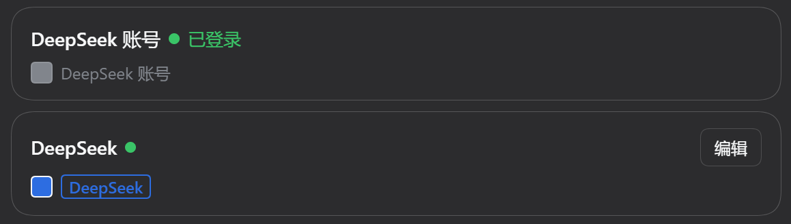

# dsh-model-provider-info

**简体中文** · [English](README.md) · [日本語](README.ja.md) · [한국어](README.ko.md)

[](https://github.com/yanxijian/dsh-model-provider-info/actions/workflows/hygiene.yml)
[](https://www.npmjs.com/package/dsh-model-provider-info)
[](LICENSE)

<!-- translated-from: README.md sha256:a713ac6a5a5c -->

在 DeepSeek Harness 输入框的模型位里，把供应商名称显示在模型名前面，并让第三方路由有自己的一份视觉分量。

输入框有三处标出当前模型——按钮文案、根菜单里的当前值、以及每个可选行——而它自己只画目录里的模型名。
两个供应商提供同名模型时，这就成了歧义。本 bundle 接管 `conversation.input.model.label` 这个内联槽，
于是同一个标签读作 `DeepSeek 账号 · DeepSeek-V4.1-Flash` 而不是 `DeepSeek-V4.1-Flash`，
推理等级仍然作为单独的小字放在它旁边。

## 它长什么样



**设置 → 模型** 里每张供应商卡片都带一枚颜色图标，以及输入框将会画出的名字预览：DeepSeek 账号那行
保持默认的灰字，而 DeepSeek API 路由显示为它所选颜色的描边标签。

## 官方与第三方

`deepseek-account` 与 `deepseek-official` 算第一方，其余任何 provider id 都算第三方。这个划分沿用产品
自己的排序规则（`ui-model-selection` 的 `provider-order.ts`、`ui-settings-models` 的 `store.ts` 都只
特判这两个 id）。

强调按表面分级，避免列表变成一墙警告：

| 位置 | 第一方 | 第三方 |
|---|---|---|
| 模型按钮 | 普通的小字文案 | `#F61A43` 描边标签：12px、字重 600、1px 边框、`--dsw-radius-xs`、透明底 |
| 菜单里的「模型」当前值 | 同上 | 同一个标签（这里也是当前选择） |
| 展开的模型列表行 | 普通的小字文案 | `--dsw-alias-label-secondary` + 字重 500，不上色、不加边框 |

列表行是刻意做轻的：每个分组上方本来就有供应商名作标题，逐行再挂一个标签等于把供应商讲两遍，整列
会被涂成红色。

供应商挂到模型上的目录角标（`model.badge`，内建标签画的那个 `Tag`）在这里也还原了：按钮里排在名字
前面，菜单和列表行里排在名字后面。

## 配置

**设置 → 模型**，两处，按浏览器保存：

**每张供应商卡片**末尾有一枚颜色图标：点一下为该供应商选色，图标显示当前生效的颜色（描边更重表示这个
供应商有自己的颜色，而不是跟随默认）；面板里的「跟随默认」可以回到默认色。

**底部卡片**设默认值：

| 选项 | 默认 | 作用 |
|---|---|---|
| 默认颜色 | `#F61A43` | 图标里选；没有单独配色的供应商用它 |
| 列表行也用颜色 | 关 | 关：展开的行只有色调与字重的差别。开：它们也用描边标签 |
| 官方路由也显示供应商 | 开 | 关：`deepseek-account` / `deepseek-official` 只显示模型名 |

给 DeepSeek 自己的路由选了颜色时，那条路由也会一并切换成描边标签——显式选颜色就是要看见它。两处共用
同一份实时记录，改完输入框立刻跟着变。

## 安装

```sh
dsh plugin --profile <profile> add dsh-model-provider-info
```

桌面用户走 **插件 → 添加插件**；在运行 DSH Desktop 的机器上，上面那条 CLI 命令指向的是 `profiles/web`，
不是 App 实际使用的 profile。

从本地检出安装：`dsh plugin --profile <profile> add link:/path/to/dsh-model-provider-info`。

无构建步骤、无运行时依赖、无网络访问。升级 DSH 不会把它删掉：它注册的是一个官方槽，而不是去 patch
编译好的 bundle。

## 几个刻意的取舍

- `#F61A43` 是默认强调色——一个字面颜色而非主题 token，因为它是用户自己选的。其余一切都留在 token 上。
- 描边而不填充：同色相的字压在自家浅色底上会掉约五分之一的对比度，而 1px 描边本身已经足够像徽标。
- 12px / 600 而不是设置页 `Custom` 标签的 11px / 400：这个强调色是中调，在浅色卡片上约 4.07:1、在
  深色输入框底上约 3.4:1，11px 的常规字重撑不住。
- 边框用 1px 而不是 0.5px：100% DPI 下 Windows 会把半像素线渲染成发虚的一条，或者直接丢掉。
- 供应商 span 保持纯 inline，与 13px 模型名共享基线。
- 芯片的框向下多 1px，而不是把文字往上挪：inline 盒子的竖直 padding 只扩展边框、不移动文字，所以
  标签始终待在它与模型名共享的基线上。1px 是全部余量——宿主把标签包在 20px 行高、`overflow: hidden`
  的盒子里，而芯片本身已经 18px 高。全小写标签（如 `wps`）在框内仍会低约 1px，那是字形没有上伸部
  造成的；上移墨迹会破坏它与模型名的基线，因此接受现状。
- 不需要 `priority`：0.2.1 起宿主这个 single 槽没有内置占用者。

## 限制

- 只改显示。选中、搜索、焦点、勾选标记、`/model` 命令弹窗和按钮的无障碍名称仍由模型选择器负责。
- 配置存在 `localStorage` 的 `dsh-model-provider-info/settings/v1` 下，是按浏览器而不是按 profile 保存的。
- 名字过长时仍会在按钮里省略；描边标签和目录角标也算进这段宽度。

## 发布

包以 `dsh-model-provider-info` 发布在 npm 上；`repository`、`homepage`、`bugs` 都已指向本仓。要发一个
改动，先升 `version`，然后：

```sh
npm publish --registry https://registry.npmjs.org --access public
```

包未加 scope，`--access public` 其实是隐含的；写出来只是把意图说清楚。npm 的 `repository` 字段要继续
指向插件目录里登记的这个仓库，否则两边关联不上。

## 许可证

[MIT](LICENSE)
