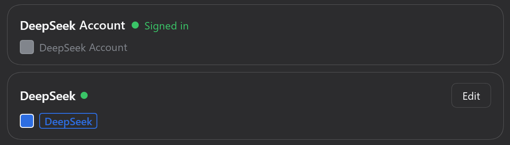

# Provider before model name

Shows the provider name before the model name in the DSH Web composer's model seat, and gives
official and third-party routes different visual weight.

## What it changes

The composer names the current model in three places, and by itself renders only the catalog name:

1. the model button at the bottom right of the composer (trigger);
2. the current value of the **Model** row in the menu (menu);
3. every row of the expanded model list (option).

This plugin takes over all three through the `conversation.input.model.label` inline slot, so the
label reads `DeepSeek Account · DeepSeek-V4.1-Flash`; the reasoning effort (such as `High`) stays a
separate caption rendered by the selector.

## First-party vs third-party

`deepseek-account` (DeepSeek Account) and `deepseek-official` (DeepSeek API Key) are first-party;
every other provider id (a relay, a self-hosted gateway, another vendor) is third-party. The split
follows the product's own ordering (`provider-order.ts` in `ui-model-selection`, `store.ts` in
`ui-settings-models` both special-case exactly these two ids).

Emphasis is graded by surface, so the screen does not become a wall of warnings:

| Surface | First-party | Third-party |
|---|---|---|
| Model button | plain caption text | **`#F61A43` outlined chip**: 12px / weight 600, 1px red border, `--dsw-radius-xs`, transparent fill |
| Menu "Model" current value | same as above | same (this is also the current selection, worth the same weight) |
| Expanded list rows | plain caption text | `--dsw-alias-label-secondary` + weight 500, **no colour, no border** |

Why the rows are toned down: every row already has a provider heading above it, so a red chip on
each row would say the provider twice and turn the column into noise.

The catalog badge (`model.badge`, the `Tag` the host's built-in label draws) is reproduced as well:
before the model name in the trigger, after it in menus and rows.

## Configuration

**Settings → Models**, two places, both stored in the browser:

**Every provider card** ends with a colour icon: click to pick a colour, and the icon shows the
colour in use (a heavier ring means the provider has its own colour rather than following the
default); the board's "Follow the default" entry goes back to it.

The card at the bottom of the page sets the defaults:

| Option | Default | Effect |
|---|---|---|
| Default colour | `#F61A43` | Picked from the icon; used by providers without a colour of their own |
| Colour the list rows too | off | Off: rows differ by tone and weight only. On: rows get the outlined chip as well |
| Show the provider on DeepSeek routes | on | Off: `deepseek-account` / `deepseek-official` show the model name alone |

Choosing a colour for one of DeepSeek's own routes switches that route to the chip as well — an
explicit colour is a request to see it.

Both surfaces share one record, so the composer's model seat updates as soon as a change is made.

## Deliberate trade-offs

- **`#F61A43` is a literal colour, not a theme token**: this is the only place in the plugin that
  breaks "tokens only", and it lives in `DEFAULT_SETTINGS.accent` at the top of `client.js`;
  switching the colour or returning to a token is a one-line change.
- **Outlined, not filled**: accent text over a tint of its own hue loses about a fifth of its
  contrast, and a 1px border already reads as a badge.
- **12px / 600 rather than the Settings `Custom` tag's 11px / 400**: `#F61A43` is a mid-tone red at
  roughly 4.07:1 against the light card and 3.4:1 against the dark composer surface (about
  `#2C2C2E`); an 11px regular weight cannot carry it, so size and weight compensate.
- **A 1px border rather than 0.5px**: at 100% / 125% DPI Windows thins a half-pixel line into a
  blur or drops it entirely.
- **The provider span stays a plain inline element**, sharing the baseline of the 13px model name;
  making it inline-flex would introduce a 1–2px baseline offset.
  - **The chip's frame grows 1px downward rather than the glyphs moving up**: vertical padding on an
    inline box extends the border without moving the text, so the label keeps the baseline it shares
    with the model name. One pixel is the whole budget — the composer wraps the label in a 20px line
    box with `overflow: hidden` and the chip is already 18px tall. The expanded list's rows are only 18px, so the chip skips that pixel there — adding it took the bottom border with it. Lowercase-only names (`wps`) still read about a pixel low inside the frame
    because they have no ascender, while names with capitals or CJK fill the ascent. That
    difference belongs to the glyphs, and nudging the ink would break the baseline, so it is
    accepted.
- **No `priority` needed**: since 0.2.1 the host's single slot has no built-in occupant, so a plain
  registration is enough.

## Notes

- Display only: selection, search, focus, check marks, the `/model` command popup and the button's
  accessible name stay owned by the native model selector.
- Preferences live in the browser's `localStorage` (key `dsh-model-provider-info/settings/v1`), so
  they are **per browser**, not per profile.
- Long model names are still ellipsized, and the provider chip and catalog badge share that width.
- To go back to the default, disable or remove the plugin on the **Plugins** page.
