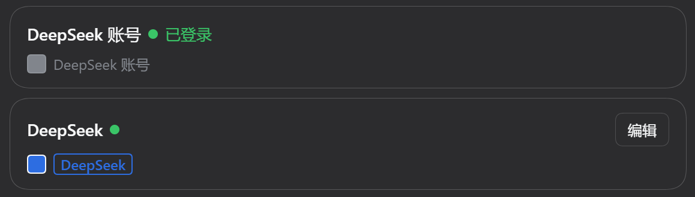

# 模型名前显示供应商

在 DSH Web 输入框的模型位里，把供应商名称显示在模型名称前面，并按「官方 / 非官方」给出不同的视觉分量。

## 它改变了哪里

输入框里“当前模型”有三处显示位置，默认只显示目录里的模型名：

1. 输入框右下角的模型按钮（trigger）；
2. 菜单里 **模型** 那一行的当前值（menu）；
3. 展开后的模型列表每一行（option）。

本插件通过 `conversation.input.model.label` 内联插槽接管这三处，显示成
`DeepSeek 账号 · DeepSeek-V4.1-Flash`；后面的推理等级（如 `High`）仍由选择器单独显示。

## 官方与非官方的区分

判定：`deepseek-account`（DeepSeek 账号）与 `deepseek-official`（DeepSeek API Key）算第一方，
其余任何 provider id（中转站、自建网关、别家厂商）算第三方。这个口径取自产品自己的排序规则
（`ui-model-selection` 的 `provider-order.ts`、`ui-settings-models` 的 `store.ts` 都只特判这两个 id）。

强调强度按「表面」递减，避免整屏警报：

| 位置 | 第一方 | 第三方 |
|---|---|---|
| 模型按钮 | 灰色 caption 小字 | **#F61A43 描边小标签**：12px / 字重 600、1px 红色描边、`--dsw-radius-xs` 圆角、透明底 |
| 菜单「模型」当前值 | 同上 | 同上（这里也是「当前选择」，值得同样的强度） |
| 展开的模型列表行 | 灰色 caption 小字 | `--dsw-alias-label-secondary` + 字重 500，**不上色、不加边框** |

列表行降级的原因：每一行上方本来就有按供应商分组的组标题，逐行再挂一个红标签等于同一组里
供应商讲两遍，整列红框会变成噪音。

目录角标（`model.badge`，宿主内建标签用的那个 `Tag`）也已还原：触发按钮里排在模型名前，
菜单与列表行里排在模型名后。

## 配置

**设置 → 模型**，两处，都保存在浏览器本地：

**每个供应商卡片**底部有一个颜色图标：点一下即可选色，图标本身显示当前生效的颜色（带粗描边表示这个供应商有自己的颜色，而不是跟随默认）；面板里的「跟随默认」可以回到默认色。

页面底部卡片设默认值：

| 选项 | 默认 | 作用 |
|---|---|---|
| 默认颜色 | `#F61A43` | 图标里选；没有单独配色的供应商用它 |
| 列表行也用颜色 | 关 | 关：列表行只有灰度与字重差别；开：列表行也用描边标签 |
| 官方路由也显示供应商 | 开 | 关：`deepseek-account` / `deepseek-official` 只显示模型名 |

给 DeepSeek 自己的路由也设了颜色时，那条路由会一并切换成描边标签——显式选颜色就是要看见它。

两处共用同一份记录，改完输入框里的模型位立刻跟着变。

## 几个刻意的取舍

- **#F61A43 是字面颜色，不是主题 token**：这是全局唯一的一处违背「只用 token」的地方，
  它被收在 `client.js` 顶部的 `DEFAULT_SETTINGS.accent` 里，换色或改回 token 只改一行。
- **描边而不填充**：同一色相的字压在浅色底上会再掉约五分之一的对比度，而 1px 描边本身已经足够像徽标。
- **12px / 600，而不是设置页 `Custom` 标签的 11px / 400**：#F61A43 是中调红，在浅色卡片上约 4.07:1、
  在深色输入框底（约 `#2C2C2E`）上约 3.4:1，11px 的常规字重撑不住，靠字号和字重补。
- **边框用 1px 而不是 0.5px**：Windows 100% / 125% 缩放下半像素线会被抽稀成发虚的一条或直接消失。
- **供应商 span 保持纯 inline**，与 13px 模型名共享基线；改成 inline-flex 反而会引入 1–2px 的基线偏移。
  - **芯片的框向下多 1px，而不是把文字往上挪**：inline 盒子的竖直 padding 只扩展边框、不移动文字，
    所以标签始终待在它与模型名共享的基线上。1px 是全部预算——宿主把标签包在 20px 行高、`overflow:
    hidden` 的盒子里，而芯片本身已经 18px 高；加到 1.5px 时下边框会被裁掉一半。全小写标签（如
    `wps`）在框内仍会低约 1px，含大写或中文的名字则填满 ascent；这个差异属于字形，上移墨迹会破坏
    基线，因此接受现状。
- **不需要 `priority`**：0.2.1 起宿主这个 single 槽没有内置占用者，直接注册即可。

## 注意

- 只改显示：选中、搜索、焦点、勾选标记、`/model` 命令弹窗和按钮的无障碍名称仍由原生模型选择器负责。
- 配置项存在浏览器的 `localStorage`（键 `dsh-model-provider-info/settings/v1`），是**按浏览器**而不是按 profile 保存的。
- 模型名过长时仍会省略，供应商标签与目录角标也占用按钮宽度。
- 想恢复默认，在 **插件** 页面禁用或移除本插件即可。
